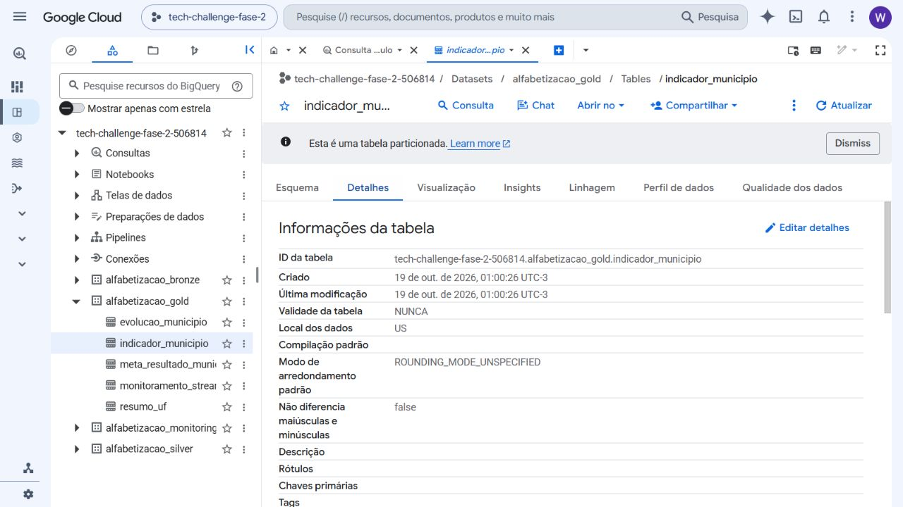
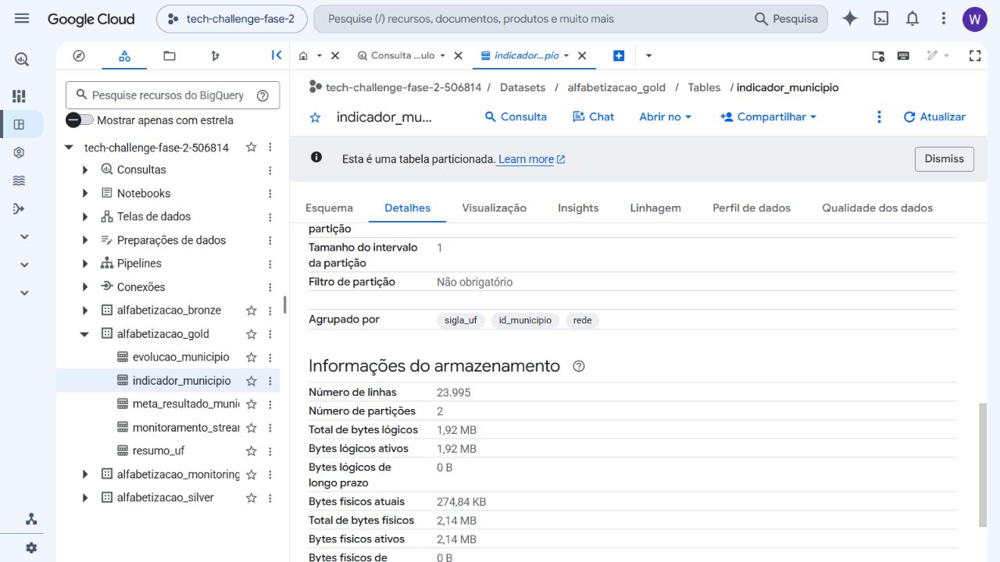
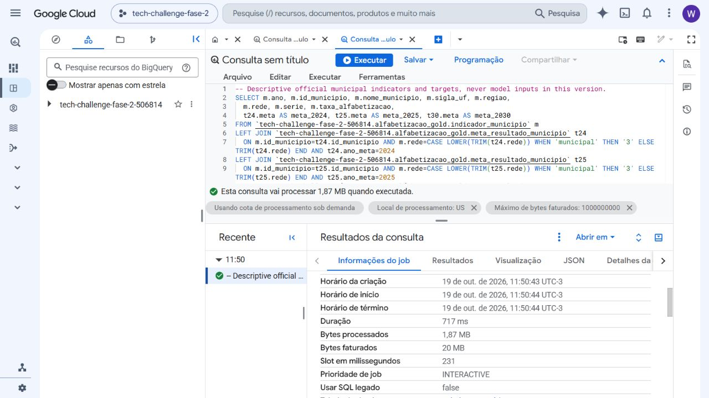
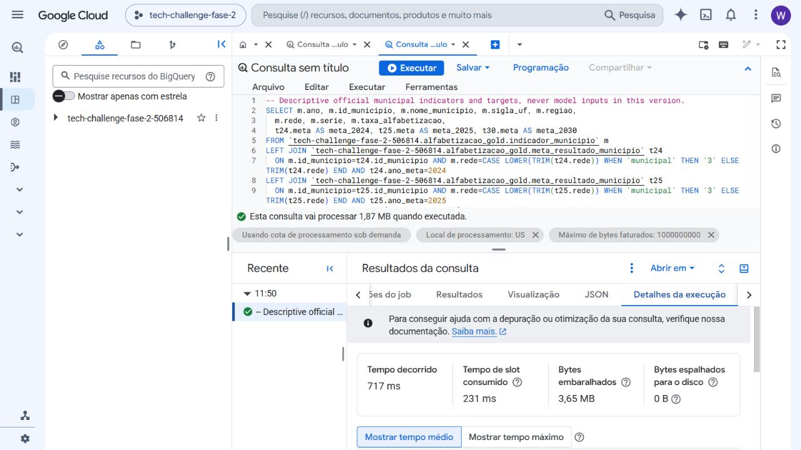
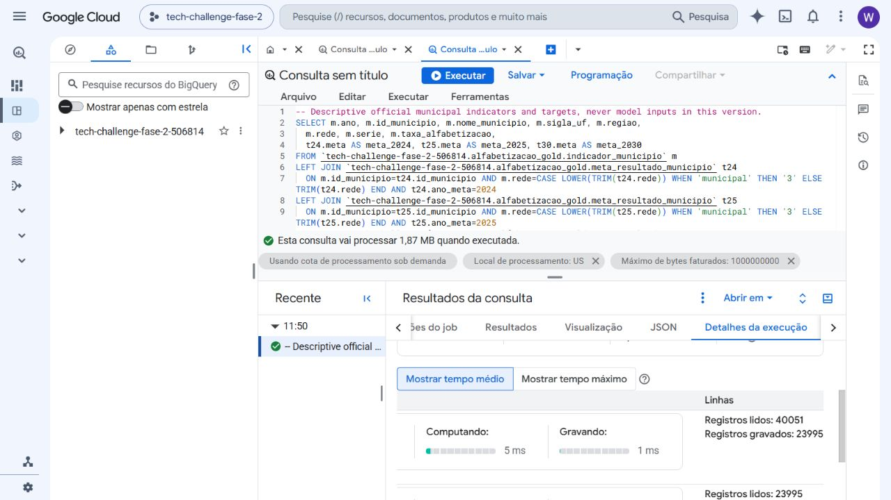

# Evidências visuais reais do GCP

Capturas realizadas no console Google Cloud, em 19/10/2026, com o projeto `tech-challenge-fase-2-506814`. São imagens reais da interface, sem reconstrução ou geração de telas.

Essas capturas comprovam os dados e as consultas no GCP. **O treinamento dos classificadores foi local**, e não é apresentado como execução de ML no GCP. Os arquivos JSON dos jobs e os hashes complementam os prints.

## Tabela e camadas

Identificação da tabela e dos datasets Bronze, Silver e Gold no explorador.

Contagem real de 23.995 linhas, duas partições e clustering da tabela municipal.

## Consulta concluída e processamento

Job `fase3_74a8f4d8dc004749acd81c572d5fc54f`: extração dos indicadores municipais e metas com normalização de rede. O painel de resultados mostra a execução concluída em 717 ms, 1,87 MB processados e 20 MB faturáveis. Bytes faturáveis não são valor monetário de uma cobrança.

O texto do editor sobre o que a consulta processaria em nova execução é a estimativa do editor. A evidência de execução já realizada está no painel inferior, com horários, duração, bytes e indicador de sucesso.

## Rastreabilidade

`screenshots_manifest.json` registra arquivos, hashes, datas dos arquivos, projeto e job associado. `municipal_gold_job.json` registra os metadados reduzidos do mesmo job. A SQL versionada está em `sql/municipal_gold.sql`.

Nenhum registro individual de aluno aparece nessas capturas. Uma captura adicional que mostrava dados da conta foi mantida em `reports/private/`, fora do versionamento.
